# Advanced data analysis — what drives a purchase, and therefore our score

Exploratory analysis of the challenge data, done on **Sat 14 Nov 2026 ≈ 13:30 CET** (3.5 h into the practice
round). Everything here is reproducible:

```bash
python avanced_data_analysis/eda_pull.py   # RawTree → $SKORE_DATA_DIR/eda/*.parquet (outside the repo), ~1 min
python avanced_data_analysis/eda.py        # → figures/*.png + numbers.json, ~3 min on a laptop CPU
```

Run these with the project's Python environment. On the serving laptop it is
`C:/Users/javil/skore_money/venv/Scripts/python.exe`; it lives outside the repository because the
repository is in a OneDrive folder and syncing an environment saturates the uplink the live server needs.

| File | What |
|---|---|
| [`eda_pull.py`](eda_pull.py) | 16 SQL queries. Aggregations run **inside RawTree** (12 M events → per-product, per-shopper, per-hour tables); only a 10% hash sample of the carousel log (200 k requests) comes down in full detail |
| [`eda.py`](eda.py) | Builds every figure and number below |
| [`levers.py`](levers.py) | Draws the summary figure (10 · score levers) from `numbers.json`, in seconds |
| [`numbers.json`](numbers.json) | Every number quoted here, machine-readable |
| [`figures/`](figures/) | The ten figures |

Data used: `shop.catalog` (5,000 products), `shop.history_events` (12.0 M organic events, 59,841 shoppers),
`shop.history_sessions` (2.0 M requests of the old carousel = 20 M impressions), plus the live `shop.requests`
and our `team_06.feedback`.

## The problem in one picture

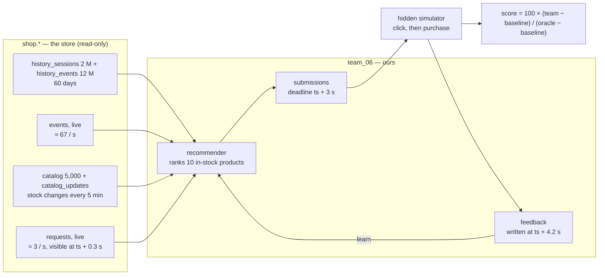

**What the score rewards.** `score = 100 × (team − baseline) / (oracle − baseline)`, clipped to [0, 100], applied
to *expected purchases per 100 requests* — on all requests (50 points) and on cold requests only (10 points);
reliability is 10 more. On the practice leaderboard at 13:16 CET the baseline was at 0.66 (cold 1.15) and the
organisers' reference at 2.09 (cold 1.79); the oracle is not published. Two consequences:

- Only **purchases** count. A click that does not convert is worth nothing, and revenue only breaks ties.
- The metric is an average over requests, so it is decided where the purchases are. In the old carousel,
  `home` pages are 20% of the requests but **2.1% of the purchases**; product and category pages are the other 98%.

## Headline findings, ranked by how much they move purchases

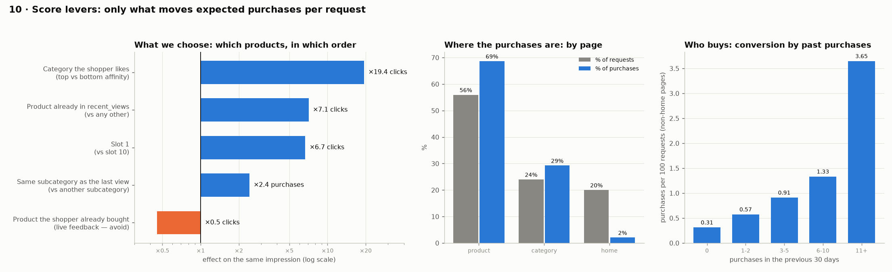

The one figure to keep in mind ([`levers.py`](levers.py) draws it from `numbers.json`): on the left, what we
control — which products we show and in which slot; in the middle and on the right, what we do not control but
tells us where precision pays — the page and how much the shopper buys.

| # | Finding | Size of the effect | Figure |
|---|---|---|---|
| 1 | **Who the shopper is matters most.** A shopper's own buying intensity and their affinity for the item's category are the two strongest predictors of a click and of a purchase | Shoppers with 11+ purchases in the first 30 days convert **3.65%** in the last 30 days vs **0.31%** for shoppers with none (12×). Top vs bottom octile of category affinity: **19×** the CTR | 6, 8, 9 |
| 2 | **Having a recent view is what makes a request worth anything** | 1.4–2.1% conversion with recent views vs 0.14% without (the `home` page): **12–14×** | 4 |
| 3 | **Item popularity** (organic purchases, cart rate) | Monotone: top decile ≈ 1.7% CTR per impression vs 0.06% for the bottom | 6, 9 |
| 4 | **Position** | Slot 1 gets **6.7×** the clicks of slot 10. It affects the click, not the purchase after the click | 6, 9 |
| 5 | **Same subcategory as the last viewed product** | **2.4×** the purchases per impression of a same-category, other-subcategory item; request conversion rises from 1.0% (no such item shown) to 2.3–3.3% (3–6 shown) | 6 |
| 6 | **A hidden bargain segment: Android × (Murcia, Andalucía, Canarias)** | Converts **3.7%** vs 1.2–1.75% for every other device × region cell; buys cheaper products (median 17 € vs 22–25 €) | 5 |
| 7 | **Device predicts category** (useful when there is nothing else: new shopper on `home`) | iOS: Beauty & Health ×1.38, Fashion ×1.22 · web: Books & Media ×1.27, Beauty ×0.63, Fashion ×0.65 | 5 |
| 8 | **Re-purchases: the log and the live simulator disagree** — see the warning below | Log: already-bought items get 11× the CTR. Live: about half the CTR | 6 |
| 9 | **What does not matter**: hour of day, day of week, item age, brand match; price has no clean effect once the item is clicked | Conversion differs by <3% across days of the week; hourly differences are inside the confidence intervals | 4, 6 |
| 10 | **The history is stationary**: no category gains or loses share over the 60 days | Weekly category share stays within 0.96–1.03 of its average | 3 |

> **Warning — satiation.** In the 60-day log, 46% of the carousel purchases are of a product the shopper had
> *already bought* before, and an already-bought item is clicked 11× more (3.04% vs 0.27%). Taken at face value
> that says "show them what they bought". The live feedback says the opposite: for known shoppers served the
> best-sellers baseline, items they had bought in the history got 12 clicks in 11,338 impressions (0.11%) against
> 391 in 167,902 (0.23%) for the rest, and 3 purchases against 113. The live sample is small, but it agrees with
> the brief ("a shopper who already bought a product tends not to want it again") and with the leaderboard, where
> the best-sellers baseline converts 1.15 on cold requests and only 0.66 overall. **Reading: use past purchases
> as evidence of taste (category, subcategory, price level), but do not re-show the exact products.** This must be
> confirmed on live feedback before relying on it.

## 1 · Univariate distributions

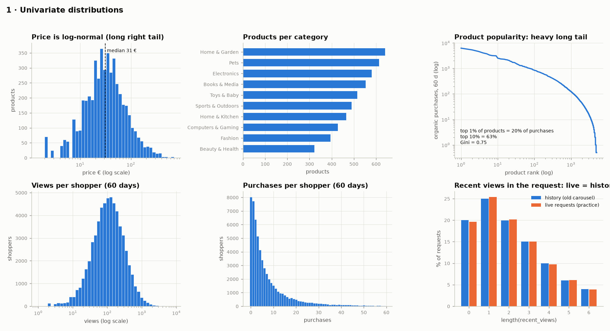

- **Price** is log-normal: median 31 €, p10–p90 = 10–97 €, maximum 644 €.
- **Popularity is a long tail**: the top 1% of products (50) take 19.5% of the organic purchases and the top 10%
  take 62.5% (Gini 0.75); 191 products were never bought. The baseline shows only the 10 at the very top.
- **Shoppers**: median 105 views and 4 purchases in 60 days; 13% never bought; the top 1% have over 1,000 views.
- **Requests**: the live stream has the same shape as the history (20% without recent views, then 26 / 20 / 15 /
  10 / 6 / 4% with 1–6), so what the log teaches about context transfers. Live adds what the log lacks: 30% of
  requests are from new shoppers.

## 2 · Outliers

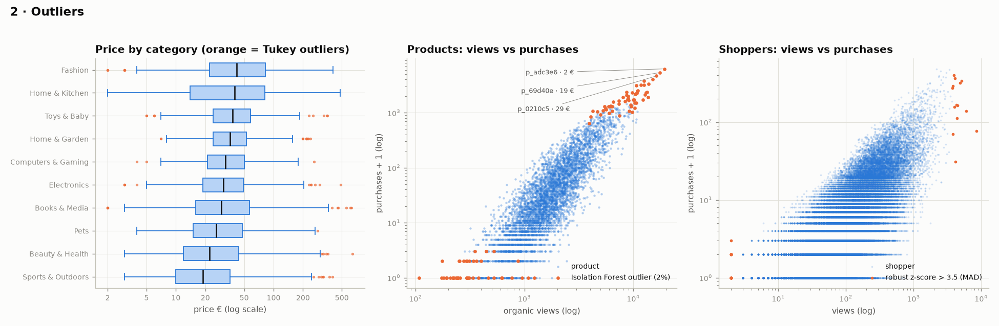

- **Price**: 137 products are Tukey outliers on log-price, on both ends (2 € and 300–640 €). They are real
  catalogue entries, not errors — keep them, but work with log-price.
- **Products**: an Isolation Forest (2% contamination) flags the two ends of the popularity axis — the handful
  of best sellers (the top one, `p_adc3e6`, costs 1.99 € and alone is 1.1% of all purchases) and the never-bought tail.
- **Shoppers**: 143 are extreme on activity by a robust z-score (median absolute deviation). No bot-like pattern:
  their purchases scale with their views like everyone else's.

## 3 · Time

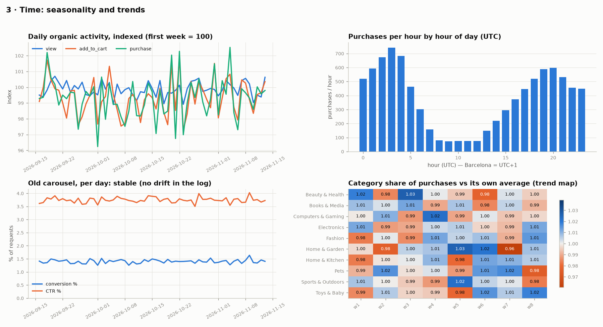

- Daily volume is flat (±3%) for the 60 days, and so are the carousel's CTR (≈3.75%) and conversion (≈1.4%).
- There is a strong daily **volume** cycle (10× between the peak at 03 h UTC and the trough at 09 h UTC), but
  conversion does not change with the hour (figure 4).
- **No trends in the history**: every category keeps its share of purchases within 0.96–1.03 of its average,
  week after week. The trends the brief announces for the final can only be seen in the live `shop.events`.

## 4 · Which request context converts?

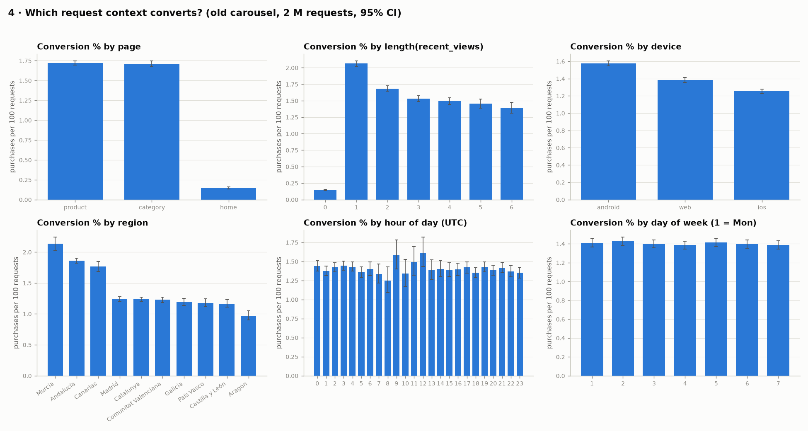

Ratio between the best and the worst level of each variable, on all 2 M requests of the old carousel:
`length(recent_views)` 14× · page 12× · region 2.2× · device 1.26× · hour 1.29× (noise) · day of week 1.03×.
Conversion is highest with exactly one recent view (2.06%) and decays slowly to 1.39% with six.

## 5 · Interactions

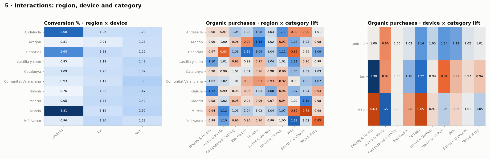

- The "region effect" is really one segment. Android shoppers in Murcia, Andalucía and Canarias convert 3.8 /
  3.1 / 2.7%; every other cell is between 0.8 and 1.6%. On product and category pages that segment has CTR 7.2%
  (others 3.6–4.6%), 52% of its clicks end in a purchase (others 33–38%) and its average ticket is 20 € (others
  33–44 €). In the organic events it buys cheaper (median 17 € vs 22–25 €) and more often (6.5 purchases per 100
  views vs 4.6–5.5). The old carousel's cheap best sellers suit it; for everyone else there is room to do better.
- Device shifts the category mix by up to ±40%; region shifts it by ±10–15% at most.

## 6 · What makes one shown item get clicked and bought?

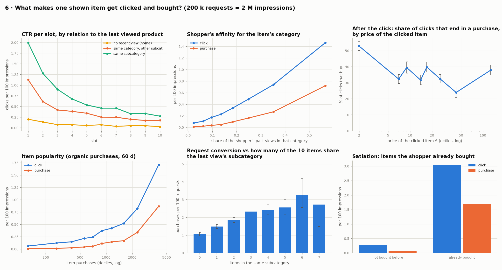

200 k requests exploded into 2 M (request, slot) impressions.

- When the request had a recent view, the old system showed **only products of the same category** as the last
  viewed one (100% of impressions; 17% in the same subcategory). The log therefore says nothing about
  cross-category recommendations.
- Same subcategory beats same-category-other-subcategory at every slot: 0.73% vs 0.39% CTR and 0.33% vs 0.14%
  purchases per impression.
- Products that are in the shopper's `recent_views` are 1.4% of the impressions and get 7× the CTR (2.95% vs 0.42%).
- Once an item is clicked, the share of clicks that end in a purchase shows no clean trend with price (24–40%
  across the range); only the ≈2 € bucket stands out (53%), and that is the top seller.

## 7 · Product space: correlations and PCA

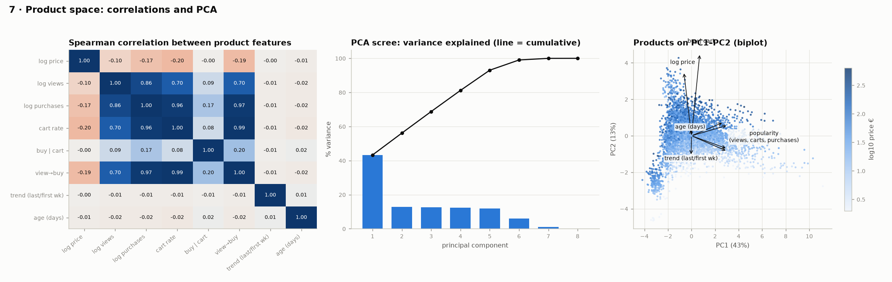

- Views, carts, purchases and cart rate are one thing (Spearman 0.70–0.99 between them): **PC1 = popularity,
  43% of the variance**.
- Price, buy-given-cart rate, trend and age are almost independent of popularity and of each other, so components
  2–5 carry ≈12–13% each. There is no hidden low-dimensional structure in the product aggregates beyond popularity.
- Price is only weakly related to popularity (Spearman −0.17): cheap sells a little more, not much more.

## 8 · Shopper space: PCA, K-means and UMAP

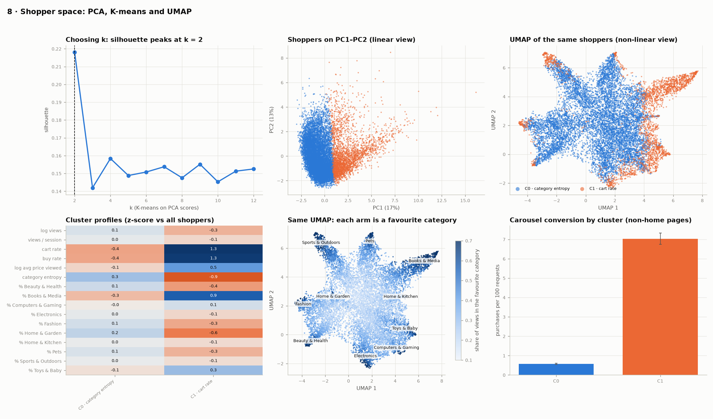

16 features per shopper (activity, cart rate, buy rate, price level, category entropy and the share of views in
each of the 10 categories), standardised.

- **PCA**: 11 components are needed for 90% of the variance — shoppers do not live on a line or a plane.
- **K-means**: the silhouette is highest at k = 2 (0.22; every k from 3 to 12 is below 0.16). The two groups are
  *browsers* (78%) and *buyers* (22%: cart and buy rates +1.3 standard deviations, fewer categories, pricier
  views). On product and category pages the buyers convert **7.0%** and the browsers **0.57%**.
- **UMAP** shows what K-means on standardised features misses: a star with one arm per favourite category.
  The median shopper puts 34% of their views in one category (a uniform shopper would put 10%).
- So a shopper is described by two things: **how much they buy** and **which categories they like**. Both are
  usable for the 70% of requests that come from known shoppers; neither exists for a new shopper.

## 9 · What matters most? Gradient boosting + SHAP

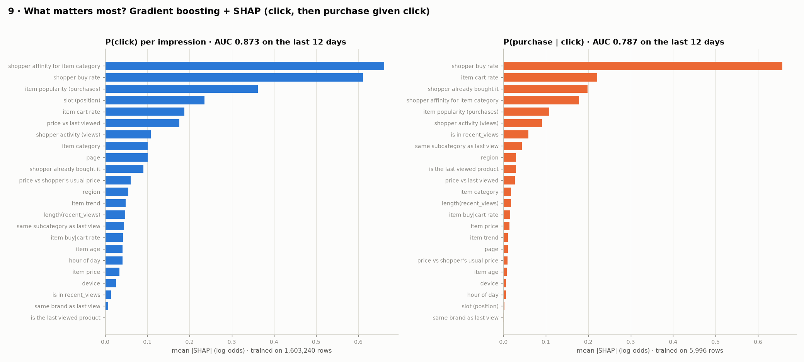

Two LightGBM models on the impressions, trained on the first 48 days and tested on the last 12; importance is
the mean absolute SHAP value (TreeSHAP).

- **P(click)**, 1.6 M training impressions, AUC 0.873 (position alone: 0.666). Order: shopper's affinity for
  the item's category → shopper's buy rate → item popularity → slot → item cart rate → price relative to the
  last viewed product.
- **P(purchase | click)**, 6.0 k training clicks, AUC 0.787. Order: shopper's buy rate → item cart rate →
  already bought → category affinity → popularity. Slot is last: position decides what gets looked at, not
  what gets bought.

## Caveats

- **Observational log of a biased policy.** The old system showed best sellers plus noise, and only same-category
  products. These are associations inside what it chose to show; no inverse-propensity correction was applied here.
- **Shopper features use all 60 days**, so they include activity after the request. The buyer effect was
  re-checked without that leak (first 30 days → last 30 days: 12×). The affinity and "already bought" effects
  were not, except that "already bought" only counts purchases made before the request.
- **Importance is not headroom.** A feature can rank low because the old system never varied it.
- **The final round has unseen shoppers and products.** Findings 1 and 8 need history; findings 2–7 do not.

## What this means for the recommender

1. On product and category pages, take candidates from the last viewed product's category, favouring its
   subcategory, and order them by expected purchase — best first, because of position.
2. For known shoppers, weight by their category affinity; treat their past purchases as taste, and test on
   live feedback whether excluding the exact products already bought helps.
3. For new shoppers, use what the request carries: the recent views, then device and region (the bargain
   segment, the device → category shifts).
4. Skip hour and day-of-week features.
5. Get trends, new products and price changes from the live tables; the history has none.
6. Cross-category recommendations are unexplored territory: only live feedback can say whether they pay.
